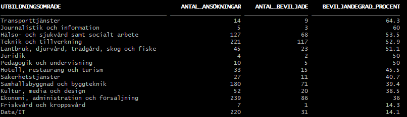
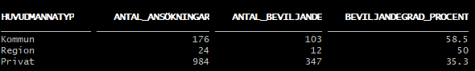
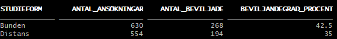
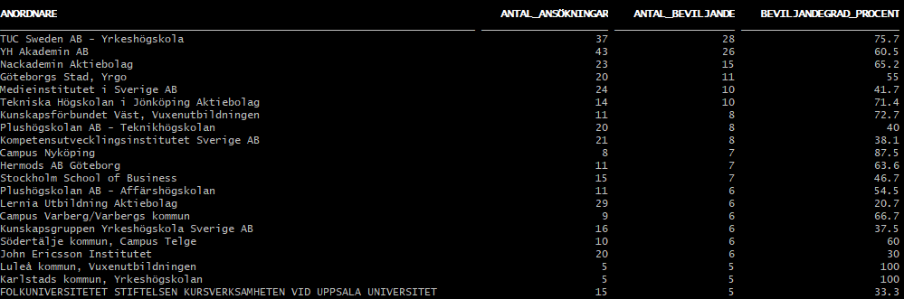

# the_skool_marko_tadic
### Labuppgift SQL1  

## Uppgift 1 - Grundläggande EDA
Hittar den som ```01_EDA.sql``` under ```scripts```

## Uppgift 2 & 3 - Domänexpert intervju / Datadrivna beslut.
Under ```scripts``` hittar du ```interview.md``` samt ```03_query.sql``` för frågorna från intervjun.   
(Tack Nike för att du delade med dig av dina anteckningar)

## Uppgift 4 
Hittar den som ```04_EDA.sql``` under ```scripts```

## Uppgift 5 - Analys av utbildningsansökningar - The Skool
Detta arbete syftar till att applicera SQL-kunskaper för att hjälpa utbildningsanordnaren **The Skool** att navigera i myndigheternas beslut gällande utbildningsansökningar. Genom att strukturera och analysera datan får ledningen ett konkret stöd för att fatta relevanta, datadrivna beslut inför framtida utbildningsstarter och veta var de ska rikta sina resurser.

Denna lab bygger på en verklig tabellanalys från 2025 som har konverterats till CSV-format och exporterats till en databasmiljö.

### Bakgrund och syfte
För att utbildningsanordnare ska beviljas att bedriva YH-utbildningar (program eller kurser) med statligt finansiellt stöd krävs en formell ansökan till myndigheten. Varje enskild ansökan måste innehålla:
- En tydlig beskrivning av hur utbildningen är **förankrad i arbetslivet**
- Bevis på att det finns ett reellt **kompetensbehov** för arbetsmarknaden för de studerande. 
- Dokumentation som styrker att ett visst antal personer från relevanta branscher i arbetslivet kan **verifiera och stödja detta behov.**

### Analysfokus och affärsfrågor 
Eftersom **The Skool** är en helt ny skola utan tidigare utbildnings- eller betygshistorik, ligger fokus helt på att analysera externa marknadstrender och konkurrenters historiska data. Utifrån verksamhetens behov har analysen i SQL fokuserat på följande kärnområden för att skolan ska slippa "skjuta vilt":
- Beviljandegrad och utbildningsområden: Vilka specifika utbildningsområden blir godkända, och hur stor andel av ansökningarna inom dessa områden går igenom?
- Geografisk spridning: Vilka geografiska områden och regioner är mest framgångsrika när det kommer till beviljade ansökningar?
- Nischade vs. breda utbildningar: Hur ser fördelningen ut mellan beviljade och nekade ansökningar inom smala, nischade yrkesområden?
- Utbildningsform (Distans vs. platsbunden): Vilken utbildningsform är "hetast" och har statistiskt sett störst chans att få godkänt av myndigheten?
- Konkurrentanalys: Hur ser framgången ut för andra etablerade skolor, och i hur stor utsträckning lyckas de pricka rätt och få sina ansökningar beviljade?

### Teknisk miljö och verktyg
**Databashanterare:** Oracle Database 23ai  
**Terminal:** Git Bash  
**Frågespråk:** SQL  

### Exempel på SQL-frågor och resultat
På frågan om vilka specifika utbildningsområden blir godkända och hur stor andel av ansökningar inom dessa områden går igenom så är här ett exempel:  
  
Konkurrensen bland huvudmannatyp kan vi se här:  
  
Hur det ser ut med antal ansökningar och beviljandegrad för studieform:  
  
Samt konkurrens mellan anordnare (har valt att filtrera bort anordnare med färre eller lika med 5 ansökningar):  
  

